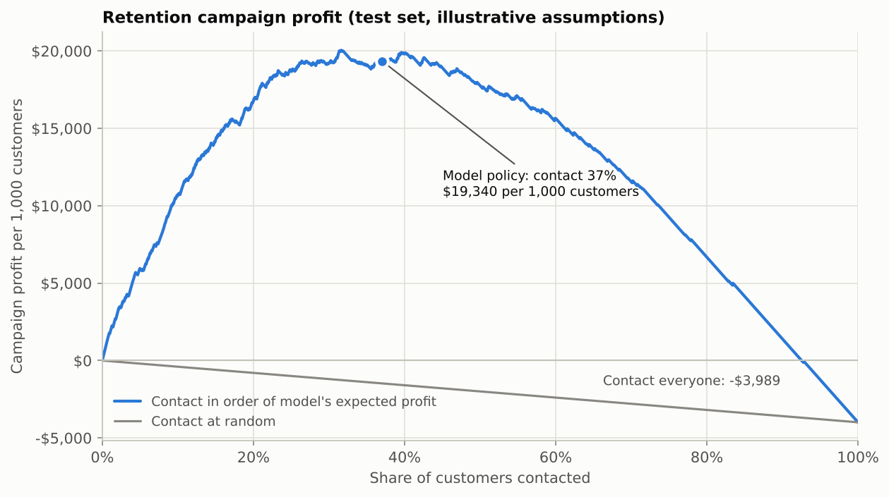
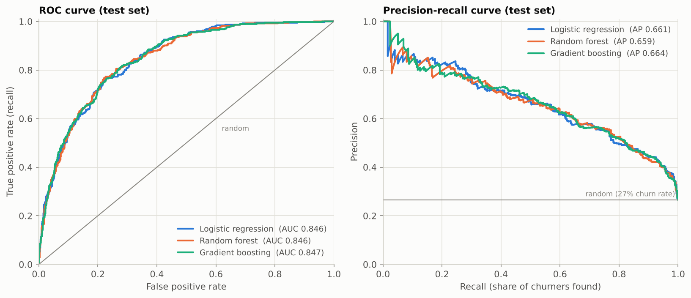
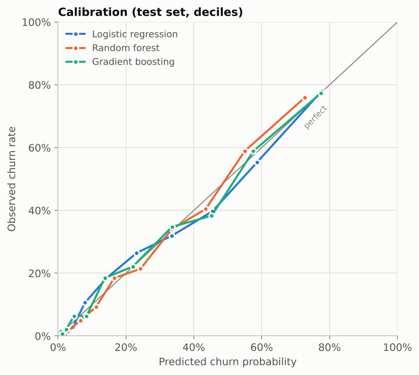
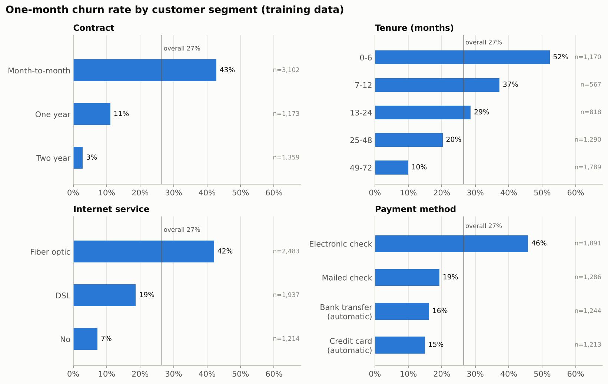
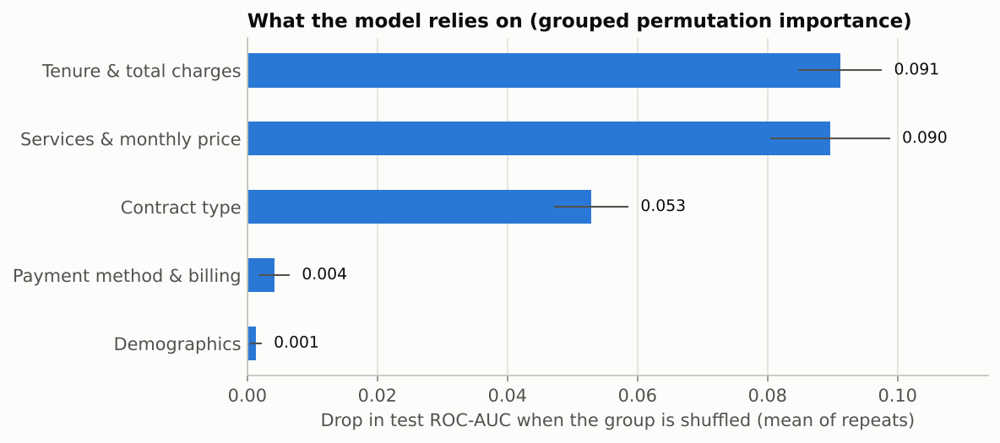

# Telco Customer Churn: From Prediction to a Profitable Retention Campaign

Most churn projects stop at "the model has 0.85 AUC". This one asks the question a retention team actually has: **which customers should we contact this month, and does it make money?**

Using the IBM Telco dataset (7,043 customers), the project builds a calibrated churn model and turns its probabilities into a per-customer contact decision. It then compares that decision against the simple rules a business would otherwise use.



## Key results

| | |
|---|---|
| **Best model** | Logistic regression, test ROC-AUC **0.846** (95% CI 0.824–0.867), well calibrated (calibration error 0.024) |
| **Campaign profit** | **$19,340 per 1,000 customers**, vs. $13,746 for "contact every month-to-month customer" and −$3,989 for "contact everyone" |
| **Is the gain real?** | Model beats the best simple rule by **$3,875–$7,405 per 1,000 customers** (95% bootstrap CI on the held-out test set) |
| **Efficiency** | Contacts 37% of customers but reaches 72% of churners; captures 53% of the profit a perfect-foresight policy would make |

The dollar figures rest on **illustrative campaign assumptions** (below). The code makes them one-line changes, and the sensitivity analysis shows how the conclusions hold up as they change.

## The question

Every month, about 27% of customers in this dataset leave. The retention team can offer a discount, but the offer costs money every time it goes to someone who would have stayed anyway. A useful model therefore has to answer three questions:

1. **Who is likely to churn?** This needs good ranking (ROC-AUC, PR-AUC).
2. **How likely, exactly?** This needs calibrated probabilities, because the decision multiplies them by dollar amounts.
3. **Is it worth contacting them?** This weighs the expected value of saving a customer against the cost of the offer.

## Approach

```
raw CSV ──► clean & validate ──► stratified 80/20 split ──► 5-fold CV model selection (train only)
                                                                      │
       contact list ◄── profit-based decision ◄── calibration check ◄─┴─► held-out test evaluation
```

- **Data cleaning.** `TotalCharges` is stored as text and is blank for the 11 customers with zero tenure, who haven't been billed yet. These become 0, and any other non-numeric value raises an error.
- **No leakage.** All tuning, model selection and the feature ablation use cross-validation on the training split only. The test set is used once, for the final report.
- **Models.** A baseline that always predicts the base churn rate, plus logistic regression, random forest and gradient boosting, each grid-searched.
- **Campaign economics.** Contacting a customer with churn probability *p* is worth:

  ```
  E[profit] = p · save_rate · (customer_value − incentive) − (1 − p) · incentive − contact_cost
  customer_value = MonthlyCharges × gross_margin × value_months
  ```

  The model policy contacts everyone with positive expected profit. This makes it value-aware: a high-bill customer at 30% risk can be worth more than a low-bill customer at 50% risk.

| Assumption | Default | Meaning |
|---|---|---|
| `contact_cost` | $5 | cost of reaching one customer |
| `incentive_cost` | $50 | retention offer, paid whenever a contacted customer accepts it (loyal customers accept too) |
| `save_rate` | 30% | share of would-be churners the offer keeps |
| `value_months` | 12 | months of revenue a retained customer is worth |
| `gross_margin` | 60% | share of revenue that is profit |

## Results

### Model comparison

| Model | CV ROC-AUC | CV PR-AUC | Test ROC-AUC | Test PR-AUC | Test Brier |
|---|---|---|---|---|---|
| Baseline (predict churn rate) | 0.500 | 0.265 | 0.500 | 0.265 | 0.195 |
| **Logistic regression** | **0.850 ± 0.012** | **0.673** | 0.846 | 0.661 | 0.135 |
| Random forest | 0.848 ± 0.010 | 0.664 | 0.846 | 0.659 | 0.135 |
| Gradient boosting | 0.849 ± 0.011 | 0.664 | 0.847 | 0.664 | 0.135 |

The three models are statistically tied: the gaps are far smaller than the fold-to-fold spread. Logistic regression was selected on cross-validated ROC-AUC, as decided before looking at the test set. With equal accuracy, it is also the simplest to explain and the fastest to train (about 2 s for the full grid search, against 30 s for the random forest).



### Feature engineering: only one idea survived

Four domain features were tested with cross-validation on the training set (logistic regression):

| Features | CV ROC-AUC |
|---|---|
| Raw columns only | 0.8464 |
| **+ log(tenure)** | **0.8504** |
| + number of add-on services | 0.8464 |
| + automatic payment flag | 0.8464 |
| + bill drift (current vs. average bill) | 0.8458 |
| + all four | 0.8497 |

Churn risk drops steeply over the first months and then flattens, and log-tenure captures that curve. The other three features add nothing the raw columns don't already encode, so they were left out. The ablation is part of the pipeline, so it can be reproduced.

### Probabilities you can trust



Predicted probabilities track observed churn rates closely across all deciles. That matters because the contact decision multiplies probabilities by dollar values.

### The business case

| Policy (test set, per 1,000 customers) | Contacted | Churners reached | Precision | Profit |
|---|---|---|---|---|
| Nobody | 0% | 0% | – | $0 |
| Everyone | 100% | 100% | 27% | −$3,989 |
| Random, same number as the model | 37% | 37% | 27% | −$1,478 |
| Every month-to-month customer | 55% | 88% | 43% | $13,746 |
| **Model (expected profit > 0)** | **37%** | **72%** | **52%** | **$19,340** |
| Perfect foresight (upper bound) | 27% | 100% | 100% | $36,412 |

The month-to-month rule is a strong baseline, since contract type is one of the strongest single drivers. The model still beats it in every one of 2,000 bootstrap resamples, because it skips low-value and low-risk customers the rule contacts.

**How sensitive is this to the save rate?** The save rate is the least certain assumption.

| Save rate | Model | Model contacts | Month-to-month rule | Everyone |
|---|---|---|---|---|
| 10% | $2,712 | 18% | −$7,751 | −$29,149 |
| 20% | $10,249 | 31% | $2,997 | −$16,569 |
| **30%** | **$19,340** | **37%** | **$13,746** | **−$3,989** |
| 40% | $30,064 | 41% | $24,494 | $8,590 |
| 50% | $40,639 | 44% | $35,242 | $21,170 |

If the offer works poorly, the fixed rules lose money while the model simply contacts fewer people and stays profitable.

### What drives churn





Tenure, the services a customer buys, and contract type carry almost all of the signal. Payment method adds a little, and demographics (gender, senior status, partner, dependents) add nearly nothing.

**Why grouped importance?** Plain permutation importance gives misleading answers on this dataset because several columns are almost copies of each other:

- `TotalCharges` ≈ `tenure × MonthlyCharges` (correlation 0.9996). Shuffling `tenure` alone produces customers who have been around for 2 months but paid for 5 years.
- `MonthlyCharges` is almost fully determined by the services a customer has (R² = 0.999 from the service columns). Shuffling one without the other creates price/service combinations that can't exist.

So linked columns are shuffled together. For the same reason, the model's individual coefficients are not presented as causal effects: the model can trade price and service coefficients off against each other.

## Limitations

- **One-month snapshot.** The label is "left within the last month", so the model predicts next-month churn. It is not a survival model, and it can't say *when* a long-tenure customer will leave.
- **Assumed economics.** Save rate, offer cost and margin are assumptions. In practice the save rate should be measured with a randomised holdout, and the model could then be extended to uplift modelling: target customers the offer persuades, not just those at risk.
- **Correlation, not causation.** Fibre customers churn more, but this data can't tell whether that's the product, the price or the type of customer it attracts.
- **Single dataset.** This is a public sample dataset of one (fictional) telecom company.

**Try different business assumptions:**

```bash
python -m churn.pipeline --save-rate 0.15 --incentive-cost 30 --gross-margin 0.5
```

**Score new customers** (same columns as the training data, `Churn` optional):

```bash
python -m churn.predict --input new_customers.csv --output contact_list.csv
# Scored 50 customers -> contact_list.csv
# Recommend contacting 18 (36%), expected profit $1,269
```

The output lists each customer's churn probability, expected profit if contacted, and a contact yes/no, sorted by expected profit.

## Project structure

```
├── churn/
│   ├── config.py        # paths, data URL + checksum, column lists
│   ├── data.py          # download, schema validation, cleaning
│   ├── features.py      # feature engineering inside the sklearn Pipeline
│   ├── models.py        # candidate models and hyperparameter grids
│   ├── business.py      # campaign economics, policies, profit curve, sensitivity
│   ├── evaluation.py    # calibration error, bootstrap CIs, grouped importance, ablation
│   ├── plots.py         # report figures
│   ├── pipeline.py      # end-to-end run  (python -m churn.pipeline)
│   └── predict.py       # score new customers  (python -m churn.predict)
├── tests/               # unit + end-to-end tests on synthetic data with the real schema
├── reports/
│   ├── metrics.json     # every number in this README
│   └── figures/
├── .github/workflows/   # CI: tests on Python 3.10 and 3.12
├── Makefile
└── requirements.txt
```

Every number in this README comes from `reports/metrics.json`. The run is fully seeded, so `python -m churn.pipeline` reproduces it exactly with the same library versions.

## Data

[IBM Telco Customer Churn](https://github.com/IBM/telco-customer-churn-on-icp4d) sample dataset (Apache-2.0), downloaded from a pinned commit and verified by SHA-256. Each row is one customer, with demographics, account details (tenure, contract, billing), subscribed services, and whether they left in the last month.
